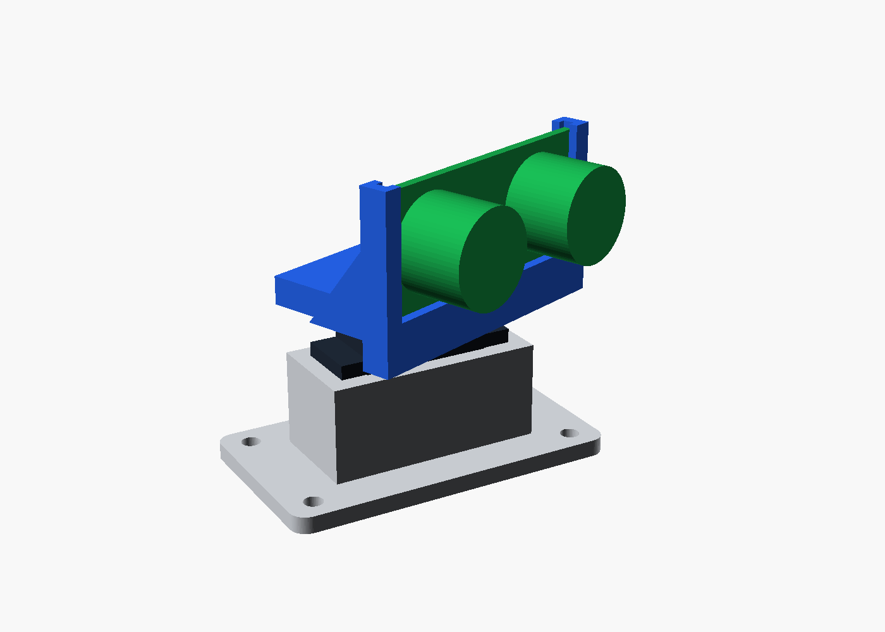
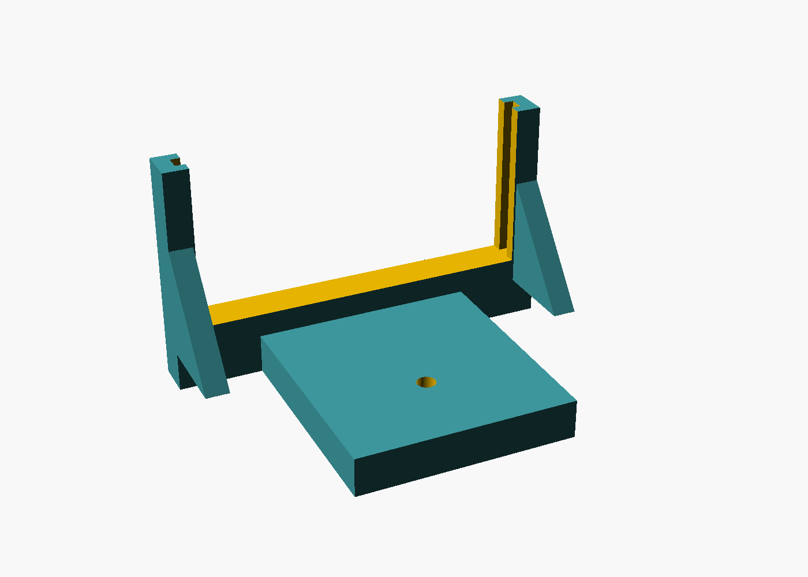

# Parametric Sensor Mount

[](https://github.com/Niyi-Momoh/parametric-sensor-mount/actions/workflows/ci.yml)

A 3D-printable pan mount for an HC-SR04 ultrasonic sensor on an SG90 micro servo, defined
entirely in OpenSCAD. Change a dimension, and the printable files are rebuilt and checked
automatically for fit, assembly and collisions across the servo's range.



> **Not yet printed.** The checks below test the digital model. Dimensions are typical
> published values and vary between manufacturers, so measure your own parts before printing.

## Results

<!-- results:start -->
| Automated check | Measured | Result |
|---|---:|---|
| Printed parts are single watertight solids | 2 of 2 | Pass |
| Servo body fits the bracket pocket | 0.000 mm³ overlap | Pass |
| Sensor fits and slides down the groove | 0.000 mm³ overlap | Pass |
| No collision from -90° to +90° (13 angles checked) | 0.000 mm³ overlap | Pass |
| Moving and fixed parts stay at least 0.5 mm apart | 0.91 mm | Pass |
| 15° ultrasonic beams are unobstructed | 0.000 mm³ overlap | Pass |

| Part | Size (mm) | Estimated PLA |
|---|---:|---:|
| Bracket | 60.0 x 34.0 x 19.9 | 12.6 g |
| Cradle | 49.5 x 34.5 x 29.0 | 7.2 g |

Estimated peak load for a 60° move in 0.1 s: 4.2 mN m, or 2.4% of a typical SG90 rating.
<!-- results:end -->

The mass and torque figures are estimates. The torque figure assumes uniform part density and
a triangular speed profile, and it ignores friction.



## Design

- **Bracket:** the servo drops into a pocket, its tabs sit on top, and a window lets the cable out below the screw pilot.
- **Cradle:** the horn sits in a recess and is held by the centre screw. The sensor board slides into a side groove from the top.
- **Print orientation:** both parts print flat on their bases as exported. The grooves run vertically, so they need no supports.
- **Guard rails:** OpenSCAD assertions reject unsafe settings, such as walls under 1.6 mm or a front opening too narrow for the sensor cans.

## Build it

```bash
python -m venv .venv
source .venv/bin/activate        # Windows Git Bash: source .venv/Scripts/activate
pip install -e ".[dev]"
pytest                           # requires OpenSCAD on your PATH
```

Change any value on the command line:

```bash
openscad -o bracket.stl -D 'part="bracket"' -D clearance=0.4 scad/mount.scad
```

Regenerating this page with `python scripts/report.py` also requires `xvfb-run` for the images.

| Hardware | Quantity |
|---|---:|
| SG90 servo with single-arm horn | 1 |
| HC-SR04 ultrasonic sensor | 1 |
| Servo tab screws (usually supplied) | 2 |
| Horn screw (usually supplied) | 1 |
| M3 screws and nuts for the chassis | 4 |

Print a test piece first and adjust `clearance`, as printers differ. Suggested settings are PLA,
0.2 mm layers, three perimeters and 20% infill. A small dab of hot glue secures the board.

## Limitations

- The parts have not been printed or fitted, and strength has not been tested.
- Vibration and impact loads are not modelled.
- Collision checks use simplified servo and sensor shapes, and the minimum gap is sampled.
- The 3D tests check geometry, not printer tolerance or material behaviour.

Licensed under MIT.
